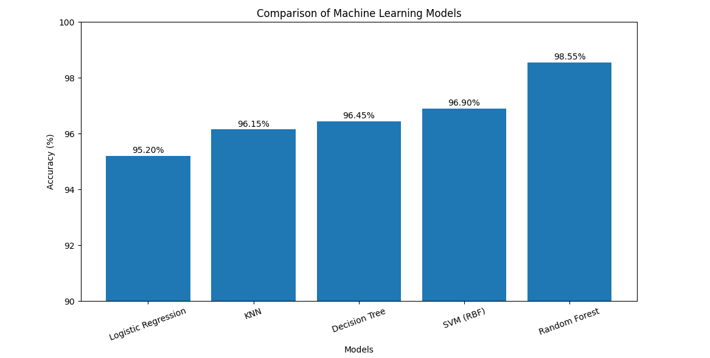

# Phishing Website Detection using Machine Learning

## Overview

This project focuses on detecting phishing websites using
supervised Machine Learning algorithms.

The main objective is to compare different classification
algorithms and evaluate their ability to distinguish
legitimate websites from phishing websites.

## Dataset

- Dataset: Phishing_Legitimate_full.csv
- Total observations: 10,000
- Number of features: 50
- Target variable: CLASS_LABEL
- 0: Legitimate websites
- 1: Phishing websites
- Class distribution: Balanced

## Project Workflow

1. Data loading and exploration
2. Data preprocessing
3. Feature scaling using StandardScaler
4. Train/Test split (80/20)
5. Machine Learning model training
6. Model evaluation and comparison

## Machine Learning Algorithms

Five classification algorithms were evaluated:

- Logistic Regression
- K-Nearest Neighbors (KNN)
- Decision Tree
- Support Vector Machine (SVM)
- Random Forest

Additional experiments were conducted with linear and RBF SVM configurations.

## Results

| Algorithm | Accuracy |
|---|---:|
| Logistic Regression | 95.20% |
| KNN | 96.15% |
| Decision Tree | 96.45% |
| SVM (RBF) | 96.90% |
| Random Forest | 98.55% |

### Best Model

Random Forest achieved the highest accuracy of 98.55%.

### Random Forest Performance

| Metric    | Score  |
|-----------|--------|
| Accuracy  | 98.55% |
| Precision | 98.60% |
| Recall    | 98.50% |
| F1-score  | 98.55% |

## Evaluation Metrics

- Accuracy
- Precision
- Recall
- F1-score
- Confusion Matrix

## Technologies

- Python
- Pandas
- NumPy
- Scikit-learn
- Matplotlib
- Seaborn
- Jupyter Notebook
  
## Model Performance Visualization

The following chart compares the accuracy of the five evaluated Machine Learning models.



## Repository Structure

```text
phishing-detection-ml/
│
├── notebooks/
│   ├── Preprocessing.ipynb
│   ├── LogisticRegression.ipynb
│   ├── KNN.ipynb
│   ├── DecisionTreeClassifier.ipynb
│   ├── SVM.ipynb
│   ├── SVM_Linear.ipynb
│   ├── RandomForestClassifier.ipynb
│   └── README.md
│
├── results/
│   └── model_comparison.png
│
├── .gitignore
├── README.md
└── requirements.txt


